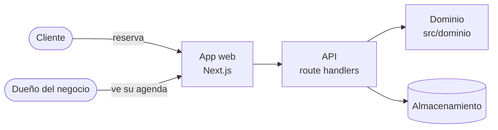

# Clase 4 · Especificación y arquitectura: specs vivas, DDD, C4 y ADR

| Campo | Valor |
|---|---|
| Fecha | Lun 30 nov · 7–9 p. m. |
| Rama | `clase-04-spec-arquitectura` |
| Duración | 2 h |
| Requiere | Clase 3 fusionada (PRD e historias con Gherkin en `main`) |

**Al terminar podrás:** escribir la spec viva de una historia, modelar el dominio con el lenguaje del negocio, dibujar la arquitectura en C4 con Mermaid, registrar decisiones en ADR y dejar listo el esqueleto de la app.

> Si el agente no sabe dónde va cada cosa, la pone en cualquier parte. La arquitectura escrita es su mapa.

---

## 0. Arranque

```bash
./scripts/iniciar-clase.sh 4
mkdir -p specs docs/adr
claude
```

## Conceptos clave

| Concepto | En una línea |
|---|---|
| Spec viva | La especificación técnica de una historia; cambia **en el mismo PR** que el código |
| Lenguaje ubicuo (DDD) | Las mismas palabras en el negocio, la spec y el código: "turno", no "booking" |
| Entidad y valor | Entidad tiene identidad (un Turno); valor solo importa por lo que vale (un Horario) |
| Agregado | Grupo que se guarda y valida junto, con una raíz que protege sus reglas |
| C4 | Arquitectura en niveles: Contexto → Contenedores → Componentes → Código |
| ADR | Registro corto de una decisión: contexto, decisión, alternativas y consecuencias |

---

## Paso a paso

### Paso 1 · La spec viva de la primera historia (15 min)

Elige la historia que construirás primero (en Turnos, `HU-001 Reservar un turno`). Plan mode:

```text
Lee docs/prd.md y docs/historias/HU-001-*.md. Escribe specs/HU-001/spec.md con:
1. Contexto (qué y por qué, 3 líneas)
2. Criterios de aceptación (copia los Gherkin de la historia, no los reescribas)
3. Reglas de negocio numeradas (R1, R2…)
4. Contrato: entradas, salidas y errores con su mensaje exacto
5. Fuera de alcance
6. Preguntas abiertas
No escribas código. Si una regla no sale del PRD o la historia, ponla en Preguntas abiertas.
```

✅ Cada error del contrato tiene un mensaje exacto (los tests lo van a comparar).

### Paso 2 · El dominio con DDD (15 min)

```text
A partir del PRD, las historias y la spec, escribe docs/dominio.md con:
- Glosario (lenguaje ubicuo): término, definición, ejemplo
- Entidades y objetos de valor, con sus atributos
- Agregados y la regla que protege cada uno
- Eventos de dominio en pasado ("TurnoReservado")
- Contextos delimitados, si hay más de uno
Usa solo términos que aparezcan en el PRD. Si propones uno nuevo, márcalo.
```

**Demo (Turnos):** agregado `Agenda` (raíz) con `Turno` dentro; la regla que protege es "dos turnos reservados no se solapan". `Horario` y `Servicio` son objetos de valor.

### Paso 3 · Arquitectura en C4 con Mermaid (15 min)

```text
Escribe docs/arquitectura.md con dos diagramas Mermaid (flowchart):
- Nivel 1, Contexto: personas y sistemas externos que hablan con el producto
- Nivel 2, Contenedores: app web Next.js, API (route handlers), almacenamiento y servicios externos
Debajo de cada diagrama, 3 líneas que lo expliquen. Mantén el MVP: nada que esté en "Fuera del MVP".
```

Ejemplo de nivel 2 para Turnos:



Abre el archivo en GitHub o en la vista previa de Markdown del editor (`Ctrl + Shift + V`) para ver el diagrama.

### Paso 4 · Decisiones en ADR (10 min)

```text
Crea docs/adr/0001-stack.md con el formato: Título, Estado (Aceptado), Contexto, Decisión,
Alternativas consideradas (al menos 2, con por qué no), Consecuencias (positivas y negativas).
La decisión: Next.js con TypeScript, Vitest y Playwright para el MVP.
```

Si tu producto pide otro stack (por ejemplo, una app móvil), este es el lugar para decidirlo y justificarlo.

### Paso 5 · El esqueleto de la app (20 min)

`create-next-app` no se instala en una carpeta con archivos, así que se crea al lado y se copia. En Windows corre estos comandos en **Git Bash** o pídele al agente que los ejecute:

```bash
npx create-next-app@latest ../esqueleto --ts --eslint --app --src-dir --no-tailwind --import-alias "@/*" --use-npm --skip-install --disable-git --yes
rm ../esqueleto/README.md ../esqueleto/.gitignore
cp -r ../esqueleto/. .
rm -rf ../esqueleto
printf '\n# Next.js\n.vercel\n*.tsbuildinfo\nnext-env.d.ts\n' >> .gitignore
npm install
npm run dev
```

Abre http://localhost:3000: debe verse la página de inicio de Next.js. Detén el servidor con `Ctrl + C`.

El esqueleto trae un **`AGENTS.md`**: instrucciones de Next.js para agentes (la versión instalada puede ser más nueva que lo que el modelo conoce). Conéctalo a tu `CLAUDE.md`:

```text
Agrega a CLAUDE.md una sección "Código" que diga: lee AGENTS.md antes de escribir código de Next.js;
el dominio va en src/dominio sin depender de Next; la UI en src/app.
Además, agrega "tools/**" y "referencia/**" a globalIgnores en eslint.config.mjs (no son código de la app)
y corre npm run lint. Muéstrame el diff.
```

```bash
git add -A
git commit -m "chore: esqueleto Next.js con TypeScript"
```

⏩ **Laboratorio:** segundo ADR y el nivel 1 del C4 si no alcanzó.

---

## Verificación

```bash
ls specs/HU-001/spec.md docs/dominio.md docs/arquitectura.md docs/adr/
grep -c '```mermaid' docs/arquitectura.md       # 2
npm run build                                   # el esqueleto compila
```

**Hecho cuando:**

- [ ] `specs/HU-001/spec.md` tiene las 6 secciones y los errores con mensaje exacto.
- [ ] `docs/dominio.md` tiene glosario, agregados y eventos.
- [ ] `docs/arquitectura.md` tiene los niveles 1 y 2 de C4 en Mermaid.
- [ ] Hay al menos un ADR en `docs/adr/`.
- [ ] `npm run build` termina sin errores.

## Para el laboratorio

1. ⏩ Escribe `docs/adr/0002-…` con otra decisión real (dónde guardar los datos, autenticación sí o no en el MVP).
2. Pide al agente que compare la spec con el dominio: "¿Hay términos de la spec que no estén en el glosario?" Corrige lo que salga.
3. Escribe la spec de la segunda historia: en la clase 6 se construyen dos en paralelo.

## Cierre

```bash
git add -A
git commit -m "docs: spec de HU-001, dominio, arquitectura C4 y ADR"
git push -u origin HEAD
gh pr create --base main --fill
```

Agrega la entrada de la clase 4 en la bitácora de `CONTEXT.md`.

## Problemas comunes

| Síntoma | Solución |
|---|---|
| `create-next-app` dice que la carpeta tiene archivos | Usa el procedimiento del Paso 5: se crea en `../esqueleto` y se copia |
| `cp` no existe en PowerShell | Usa Git Bash o pide al agente que lo haga |
| El diagrama Mermaid no se dibuja | Revisa que el bloque empiece con ` ```mermaid ` y que no haya tildes en los ids de los nodos |
| El agente diseña microservicios para un MVP | Recuérdale el alcance del PRD y pídele la versión más simple que cumpla |

## Conexión con lo siguiente

En la **clase 5** el agente construye HU-001 desde esta spec con TDD, dentro de un harness que tú programas.
